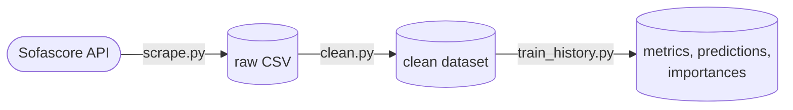

# Predicting football player ratings before kick-off with Random Forest

Code for my undergraduate thesis (Technology in Systems Analysis and Development, FATEC Sorocaba, Brazil, 2026), supervised by Prof. Dr. Maria das Graças J. M. Tomazela.

**Research question:** can Random Forest models specialised by position (goalkeeper, defender, midfielder, forward) predict a player's Sofascore rating *before* the match with lower error than a single generic model?

**Short answer:** no. Specialisation did not reduce the error. The generic model beat a position-average baseline by about 6% (MAE), but most of a match rating cannot be predicted before the game.

## Pipeline



1. **Collection** (`src/scraping/`): a crawler for Sofascore's internal web API, with rate limiting, retries with backoff, checkpoint/resume, and Pydantic validation of every row. It collected 11,977 player-match records covering all 380 matches of the 2025 Brazilian Série A.
2. **Pre-processing** (`src/cleaning/`): one function per cleaning step (missing values, types, categorical codes).
3. **Modelling** (`src/modeling/`): pre-match features only. These are home/away, opponent strength, and the player's own history up to (not including) the match being predicted: season averages of 61 statistics, plus season and last-5 averages of rating and minutes. Statistics from the match itself are never used, to avoid leaking the target.

## Method

- **Models:** one generic Random Forest (all positions) vs. four position specialists, compared against a position-average baseline and an athlete-average baseline.
- **Validation:** walk-forward (expanding window) over the last 80 matches, 10 matches per step, ordered by kick-off time.
- **Tuning:** grid search with time-ordered cross-validation inside the training window (5 folds of 30 matches, always after the training data). OOB error is reported as a check.
- **Comparison:** bootstrap 95% confidence intervals (2,000 resamples) for the MAE difference between models.
- **Interpretation:** permutation importance on the test set.

## Results

Test set: 80 matches, 2,494 player-match records.

| Model | MAE | R² |
|---|---|---|
| Position-average baseline | 0.398 | 0.01 |
| Athlete season average | 0.389 | 0.05 |
| Position specialists | 0.375 | 0.10 |
| **Generic Random Forest** | **0.374** | **0.10** |

- The generic model was 6.0% better than the position baseline and 3.9% better than the athlete's own season average.
- The generic vs. specialist difference was not significant: the 95% CI of the MAE difference included zero.
- For goalkeepers, no model beat the baseline (R² ≤ 0). Their rating depends mostly on saves and goals conceded in the match itself.
- Predictions stayed close to the mean (SD 0.16 vs. 0.54 for real ratings). The model shifts predictions with home advantage and player history, but it cannot anticipate unusually good or bad performances.

## Running it

```bash
python -m venv .venv
./.venv/bin/pip install -r requirements.txt

./.venv/bin/python terminal_shortcut/scrape.py          # 1. collect (about 1–2 s between requests)
./.venv/bin/python terminal_shortcut/clean.py           # 2. pre-process
./.venv/bin/python terminal_shortcut/train_history.py   # 3. train and evaluate (about 10 min)

./.venv/bin/python -m pytest -q                         # tests run offline
```

The dataset is **not included** in this repository. Sofascore data belongs to Sofascore, so run `terminal_shortcut/scrape.py` to rebuild it.

## Repository layout

```text
terminal_shortcut/ entry points, one per stage
src/scraping/      HTTP client, rate limiter, parsers, crawler, CSV writer
src/cleaning/      cleaning steps and pipeline
src/modeling/      features, history, estimators, evaluation, training
tests/             offline tests, one folder per stage
```

## Stack

Python, httpx, tenacity, Pydantic v2, pandas, scikit-learn, pytest.

## Note on data use

Sofascore's API is not an official public API. This code was written for academic research only: it uses low request volume and polite delays, and the collected data is not redistributed (except a single match's API responses used as offline test fixtures).

## Author

Otávio Almeida · morais.otavio@pm.me
